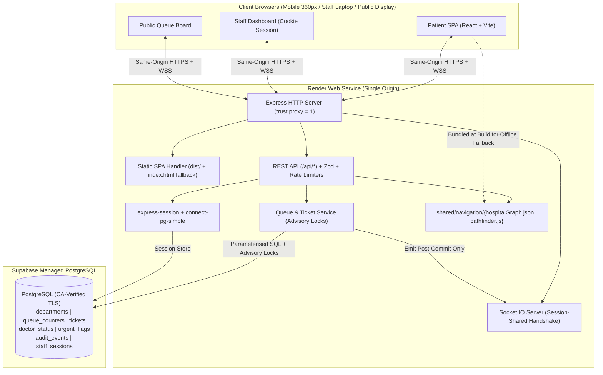

# System Architecture — OPD Saathi

**Canonical Index:** [`PROJECT_BIBLE.md`](file:///d:/HackCached/PROJECT_BIBLE.md)

---

## 1. High-Level Topology (Single-Origin Monolith)

OPD Saathi runs as a **single-origin Node.js + Express web service** on Render that serves the compiled React/Vite frontend (`dist/`), exposes the REST API (`/api/*`), and hosts the Socket.IO server (`/socket.io`), backed by a **Supabase PostgreSQL** database over CA-verified TLS.



---

## 2. Core Architectural Rules

1. **Database-First State Transitions:**
   - Every state mutation (`POST /api/tickets`, `call-next`, `start`, `complete`, `no-show`, `cancel`, `requeue`, `doctor-status`, `help-requests`) executes inside a PostgreSQL transaction.
   - Socket.IO invalidation events are emitted **strictly after `COMMIT` succeeds**. A rolled-back transaction emits zero events.
2. **Hint-Then-Refetch Realtime Pattern:**
   - Socket.IO events carry lightweight invalidation metadata (`{ departmentId, ticketId?, eventType, updatedAt }`), never sensitive capabilities or full database dumps.
   - Upon receiving an invalidation event—or upon initial mount / socket `connect` after a network drop—the client performs a standard REST `GET` to retrieve the latest authorised state.
3. **Single-Origin Routing Isolation:**
   - All backend API routes are prefixed with `/api/`.
   - Any unmatched `/api/*` request immediately receives a structured `404 Not Found` JSON response (`{ error: { code: "NOT_FOUND", message: "..." } }`) and **never** falls through to the SPA `index.html` handler.
   - Non-API GET requests (`/register`, `/my-turn`, `/staff`, `/board`, etc.) serve `dist/index.html` so deep-link refreshes work in production.
4. **Shared Navigation Engine (`shared/navigation/`):**
   - Both the Express API (`GET /api/routes`, `GET /api/slips/:publicCode`) and the React client import the exact same `hospitalGraph.json` and pure `findAccessibleRoute()` function from `shared/navigation/`.
   - This guarantees zero divergence between server-returned routes and offline client-side route recalculations (e.g., when a patient toggles **Avoid Stairs** while offline).

---

## 3. Repository Directory Structure

```text
opd-saathi/
├── PROJECT_BIBLE.md                 # Canonical index & source of truth
├── OPD_Saathi_Technical_Plan.md     # Original baseline reference (unmodified)
├── README.md                        # Setup, scripts, architecture & team handoff guide
├── package.json                     # Single root package for server + client + tests
├── vite.config.js                   # Vite build & /api + /socket.io dev proxy
├── tailwind.config.js               # Healthcare design tokens & responsive config
├── postcss.config.js                # Tailwind + Autoprefixer
├── .env.example                     # Safe placeholder environment variables
├── .gitignore                       # Prevents committing .env, node_modules, dist, certs
├── docs/                            # 12 modular specification documents
├── shared/
│   └── navigation/
│       ├── hospitalGraph.json       # 3-floor, 19-node City District Hospital graph
│       └── pathfinder.js            # Bidirectional Dijkstra + Avoid Stairs filter
├── server/
│   ├── index.js                     # HTTP + Socket.IO server entry point
│   ├── app.js                       # Express app, middleware, routes & SPA fallback
│   ├── config/
│   │   └── env.js                   # Validated environment & secret loader
│   ├── db/
│   │   ├── pool.js                  # CA-verified TLS pg.Pool & transaction helper
│   │   ├── migrate.js               # CLI migration runner (npm run db:migrate)
│   │   ├── seed.js                  # Idempotent seed runner (npm run db:seed)
│   │   └── migrations/
│   │       └── 001_init.sql         # Canonical PostgreSQL schema & indexes
│   ├── middleware/
│   │   ├── requestLogger.js         # Request ID assignment & secret-redacting logger
│   │   ├── requireStaff.js          # Server-side session gate for /api/staff/*
│   │   ├── requireTicketToken.js    # Constant-time HMAC capability verification
│   │   ├── rateLimiters.js          # IP rate limits for tickets, slips, PIN, help
│   │   └── errorHandler.js          # Consistent JSON error formatter
│   ├── services/
│   │   ├── ticketTokenService.js    # HMAC-SHA256 derivation & constant-time verify
│   │   ├── queueService.js          # Advisory-locked queue state machine & ETA
│   │   └── urgentFlagService.js     # Pre-registration & ticket help requests
│   ├── routes/                      # Modular Express route handlers
│   ├── sockets/
│   │   └── index.js                 # Authorised Socket.IO room subscriptions
│   └── test/                        # Vitest + Supertest backend & concurrency suites
└── src/
    ├── main.jsx                     # React root entry
    ├── App.jsx                      # App shell & route layout
    ├── styles/
    │   └── index.css                # CSS variables, Noto fonts, focus & print rules
    ├── lib/
    │   └── utils.js                 # cn() class merger & formatting helpers
    ├── components/
    │   └── ui/                      # Accessible Buttons, Cards, Badges, native <dialog>
    ├── i18n/                        # English (en.json) & Hindi (hi.json) dictionaries
    └── pages/                       # Patient, Staff, and Public Board screens
```
